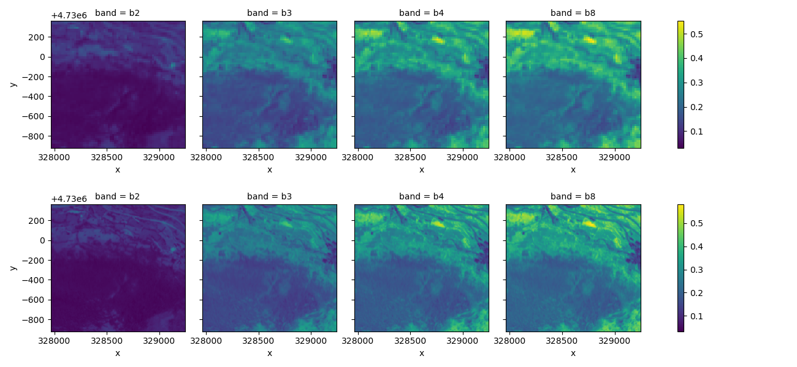

# sen2venus-pytorch-dataset
Unofficial dataloader for the [Sen2Venµs dataset](https://zenodo.org/record/6514159), baked at [CESBIO](https://www.cesbio.cnrs.fr/) by [Julien Michel, Juan Vinasco-Salinas, Jordi Inglada and Olivier Hagolle](https://doi.org/10.3390/data7070096).

## 🔍 Overview
Install with: 

```bash
pip install sen2venus-pytorch-dataset
```

This package provides a simple way to download and use the [Sen2Venµs dataset](https://zenodo.org/record/6514159) within the pytorch and Xarray ecosystems.


```python
from sen2venus import Sen2VenusSite
import matplotlib.pyplot as plt

dataset = Sen2VenusSite(root='./', site_name='SUDOUE-4', load_geometry=True, subset='all')
input, target = dataset.getitem_xarray(0)
input.plot.imshow(col='band')
target.plot.imshow(col='band')
plt.show()
```


## 🆕 Sen2Venµs v2.0 (`Sen2VenusV2`)

The dataset now has a [**v2.0** release](https://zenodo.org/records/14603764): per-patch
GeoTIFFs (instead of stacked numpy/`.pt` tensors) with **SWIR bands (B11, B12) added on
the Sentinel-2 side**. It is mirrored by [tacofoundation](https://huggingface.co/datasets/tacofoundation/sen2venus)
and `Sen2VenusV2` reads it directly through `tacoreader` — no manual download:

```python
from sen2venus import Sen2VenusV2

# same defaults as v1: subset='all' (8 bands), reflectance in [0, 1], no SWIR
ds = Sen2VenusV2(site_names='SUDOUE-4')
lr, hr = ds[0]                 # lr: (8, 128, 128) @10m, hr: (8, 256, 256) @5m

# SWIR is opt-in and only added to the Sentinel-2 (LR) tensor (Venµs has none):
ds = Sen2VenusV2(site_names='SUDOUE-4', include_swir=True)
lr, hr = ds[0]                 # lr: (10, 128, 128), hr: (8, 256, 256)

print(ds.available_sites())    # 28 sites
```

Install the v2 extra (it pins `tacoreader<1.0`, the only line that can read the legacy
tortilla format the mirror uses — `tacoreader` 2.x cannot):

```bash
pip install 'sen2venus-pytorch-dataset[v2]'
```

`Sen2VenusV2` keeps the same `subset` (`rgbnir` / `rededge` / `all`), `return_type`,
`device`, `augment` and `getitem_xarray` behaviour as the v1 classes below. Note the v2
band order is the native GeoTIFF order `[B2, B3, B4, B5, B6, B7, B8, B8A, (B11, B12)]`
(exposed on `ds.lr_bands` / `ds.hr_bands`), which differs from v1's `all` ordering.

> The v1 classes (`Sen2VenusSite`, `Sen2Venus`) below still load the original Zenodo
> `.7z` / `.pt` release and are unchanged.

## ✅ Features

- [x] **Automatic download from zenodo**: The Zenodo URLs and hashes are included. From a region name ([see the list](https://zenodo.org/record/6514159)), the corresponding subset is downloaded and decompressed. 

- [x] **x2, x4 or multi-resolution dataset loading**: you can pick the `rgbnir` or the `rededge` subset to load the x2 or the x4 low (Sentinel-2) and high (Venus) resolution patches, or specify `all` to concatenate Sentinel-2 multi-resolution bands, as in [this paper](https://hal.science/hal-04218629).

- [x] **inspired from existing frameworks**: the Sen2Venus class is inspired from [the torchsr dataset definition style](https://github.com/Coloquinte/torchSR/tree/main/torchsr/datasets) and the torchvision download utility are used.

- [x] **automatically retrieve geospatial information**: includes method to convert the dataset samples to Xarray `DataArray`s

- [x] **compatible with [sr-pytorch-lightning](https://github.com/george-gca/sr-pytorch-lightning/tree/main)**: you can train your own SR model using a [fork of sr-pytorch-lightning](https://github.com/piclem/sr-pytorch-lightning).

## 📋 TODO / WIP

- [x] better integration of download within class instantiation - currently needs to be reinstantiated
- [x] multiple regions download
- [x] pypi publishing
- [ ] parallel downloads
- [x] integration with [sr-pytorch-lightning](https://github.com/george-gca/sr-pytorch-lightning/tree/main)

## ▶️ Installation

You can install the package using `pip`:

```
pip install sen2venus-pytorch-dataset
```

or if you want to clone it first (e.g. to try out the examples):

```bash
git clone https://github.com/piclem/sen2venus-pytorch-dataset.git
cd sen2venus
pip install . 
```

## 📖 Documentation (WIP)

For more detailed information on the available parameters, methods, and best practices, please refer to the documentation.

## 🆘 Support and Issues (WIP)

If you encounter any issues, bugs, or have questions about the package, please feel free to open an issue on the GitHub repository. We appreciate your feedback!

## 🖊️ License

This package is released under the MIT License.
